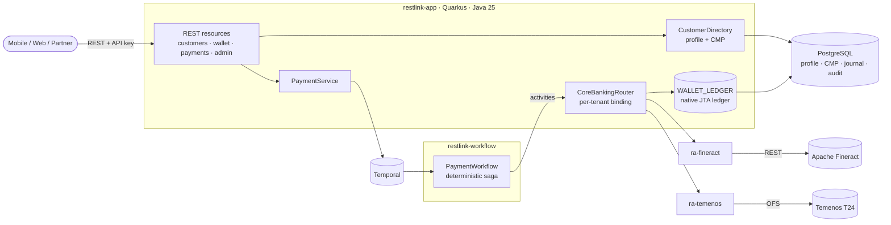
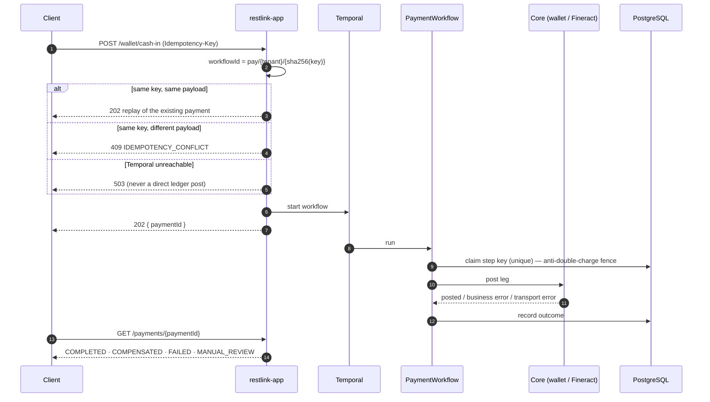

<div align="center">

# 🏦 Restlink Banking Core

**A core-agnostic digital / neo-banking platform on Java 25, Quarkus and micro-jainslee.**
Wallets, payments and customer lifecycle on top — *any* core-banking engine underneath.


[](LICENSE)

</div>

---

## Why Restlink?

Banks and fintechs in multi-country markets rarely run one ledger. Restlink puts **one banking API** in
front of several core-banking engines and picks the engine **per tenant**:

| | |
|---|---|
| 🔌 **Swappable core** | One `CoreBankingPort` SPI. Native `WALLET_LEDGER`, **Apache Fineract** or **Temenos T24/Transact**, bound per tenant. No silent fallback — an unbound tenant fails closed. |
| 💸 **Exactly-once money** | Cash-in, cash-out and transfer run as a **Temporal saga**. Idempotency is claimed *before* the engine call; a retry replays, it never posts twice. |
| 🧭 **N–N high availability** | Any node can answer any request. A node dying mid-transaction is reconciled by its peers, or parked for manual review — never guessed. |
| 👤 **Per-customer state** | Every `tenant:customer` owns its own profile row and CMP session entity. Postgres holds the full set; heap holds only a bounded LRU working set (built for 1M+ customers). |
| 🩺 **Truthful status** | A core is `live` only after a real round-trip to the engine, never because an adaptor started. |
| 🔐 **Fail-closed by default** | Default keys are rejected, Temporal-down returns `503`, trust-all TLS needs two explicit lab flags. |

---

## Architecture



### Modules

| Module | Role |
|--------|------|
| [`restlink-api`](restlink-api) | SPI: `CoreBankingPort`, sealed `CoreBankingCommand` / `CoreBankingEvent`, domain records, payment keys |
| [`restlink-workflow`](restlink-workflow) | Temporal `PaymentWorkflow` — deterministic, no I/O |
| [`ra-fineract`](ra-fineract) | Resource adaptor → Apache Fineract REST (Idempotency-Key, `externalId`, savings lifecycle) |
| [`ra-temenos`](ra-temenos) | Resource adaptor → Temenos OFS/IRIS/TAFJ (scaffold) |
| [`restlink-app`](restlink-app) | Bootstrap, profile + CMP, wallet, KYC gate, persistence, Temporal workers, HTMX admin |

### Money flow (cash-in)



Activities are at-least-once; the Postgres unique step keys make the second attempt a no-op.
Details: [`docs/design/04-temporal-payment-saga.md`](docs/design/04-temporal-payment-saga.md).

---

## Provider support

| Provider | Cash-in / cash-out | P2P transfer | Status |
|----------|:------------------:|:------------:|--------|
| `WALLET_LEDGER` | ✅ native JTA | ✅ one JTA debit + credit | Phase 1 — live |
| `FINERACT` | ✅ deposit / withdrawal legs | ⛔ fail-closed | Phase 2 — live probe + money legs |
| `TEMENOS` | ⛔ fail-closed | ⛔ fail-closed | OFS scaffold |

---

## Quick start

**Prerequisites:** [mise](https://mise.jdx.dev) (installs Zulu JDK 25 + Maven 3.9.9), Docker, PostgreSQL 16.

> **micro-jainslee** (`com.microjainslee:*:1.2.2-SNAPSHOT`) is not on Maven Central yet. Build and install it
> from [nhanth87/jain-slee](https://github.com/nhanth87/jain-slee) first (`mvn -DskipTests install`).

```bash
# 1. Toolchain
mise install

# 2. Temporal (dev stack, bound to 127.0.0.1)
docker compose -f deploy/temporal/docker-compose.yml up -d

# 3. Database
createdb restlink            # Flyway migrates on start

# 4. Configure — keys are REQUIRED (blank / "change-me" is rejected)
cp .env.example .env
#    set RESTLINK_ADMIN_KEY (>= 12 chars), RESTLINK_API_KEY, RESTLINK_DB_PASS
set -a; . ./.env; set +a

# 5. Build + run (package-dist builds with JDK 25, then lays out dist/)
./tools/package-dist.sh && dist/restlink-app/run.sh
```

The app listens on **`:8090`**.

```bash
curl -sS -X POST http://127.0.0.1:8090/customers \
  -H "X-Restlink-Api-Key: $RESTLINK_API_KEY" -H 'Content-Type: application/json' \
  -d '{"tenantId":"et","customerId":"cust-001","firstName":"Ada","lastName":"Lovelace","currency":"ETB"}'
```

Stop the dev stack when you are done: `docker compose -f deploy/temporal/docker-compose.yml down`.

---

## HTTP API

| Surface | Endpoints |
|---------|-----------|
| **Customers** | `POST /customers` · `GET /customers/{tenant}/{id}` |
| **Wallet** | `POST /wallet/open` · `/cash-in` · `/cash-out` · `/transfer` · `GET …/balance` · `…/history` · freeze / limits (admin) |
| **Payments** | `GET /payments/{paymentId}` · operator retry-reconcile / retry-compensation |
| **Admin** | `GET /admin` (HTMX dashboard) · `GET /admin/status` |

Full contract, status codes and a curl lab walkthrough: **[`docs/api.md`](docs/api.md)**.

---

## Security model

- **API keys.** `/customers` and `/wallet` require `X-Restlink-Api-Key`; operator routes require `X-Restlink-Admin-Key`.
  Keys are compared in constant time. Unset or `change-me` keys are rejected at runtime.
- **Money is fail-closed.** Temporal down ⇒ `503`; unbound provider ⇒ error, never a fallback ledger.
- **KYC gate.** New profiles are `PENDING`: cash-in is allowed, cash-out and transfer return `403` until an admin approves.
- **Audit.** Every mutating call lands in `api_audit` (time, tenant, actor fingerprint, method, path, IP, status). Bodies and raw keys are never stored; PAN is redacted.
- **TLS.** Trust-all TLS to Fineract needs *both* `insecure-tls` and `allow-insecure-tls-lab`; production leaves both off.
- **Secrets** come from the environment only. Never commit `.env`.

---

## High availability

- `RESTLINK_CLUSTER_MODE=DIST_SYNC` for N ≥ 2 nodes (`LOCAL` is single-node lab only).
- `requestId` (transport correlation) and `idempotencyKey` (money dedupe) are separate and both replicated.
- A departed node's non-money requests are adopted with a CAS; money is re-driven only by Temporal workers.

Design: [`docs/design/02-nn-ha.md`](docs/design/02-nn-ha.md).

---

## Build, test, package

```bash
mvn test                       # unit tests (JDK 25)
./tools/package-dist.sh        # → dist/restlink-app/ (run.sh + lib/ + app/html/ + configs/)
```

Deploys ship `dist/restlink-app/` only — never a WAR. Host `configs/application.properties` is never
overwritten (the script writes `.new` for review). Logging is Log4j2 only.

---

## Roadmap

| Done | Next |
|------|------|
| Native wallet ledger + Temporal money saga | Temenos OFS money operations |
| Fineract live probe + cash-in / cash-out | Cross-provider transfer (Fineract `capture()`) |
| API auth, KYC gate, API audit, HTMX admin | Apache Camel hub — ISO 8583 / ISO 20022, mobile money, FX |
| N–N HA with `DIST_SYNC` | OAuth2 open-banking gateway |

Progress log: [`docs/M1-M10-status.md`](docs/M1-M10-status.md).

---

## Documentation

| Doc | |
|-----|---|
| [`docs/api.md`](docs/api.md) | HTTP contract |
| [`docs/design/00-architecture-overview.md`](docs/design/00-architecture-overview.md) | Architecture overview |
| [`docs/design/02-nn-ha.md`](docs/design/02-nn-ha.md) | N–N request/response HA |
| [`docs/design/03-fineract-best-practices.md`](docs/design/03-fineract-best-practices.md) | Fineract integration practices |
| [`docs/design/04-temporal-payment-saga.md`](docs/design/04-temporal-payment-saga.md) | Payment saga |

---

## License

Restlink Banking Core is licensed under the **GNU Affero General Public License v3.0** — see [`LICENSE`](LICENSE).
If you run a modified version as a network service, you must offer its source to the users of that service.
