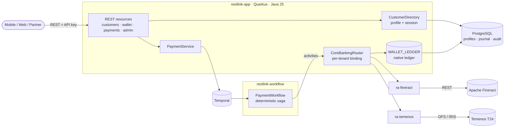
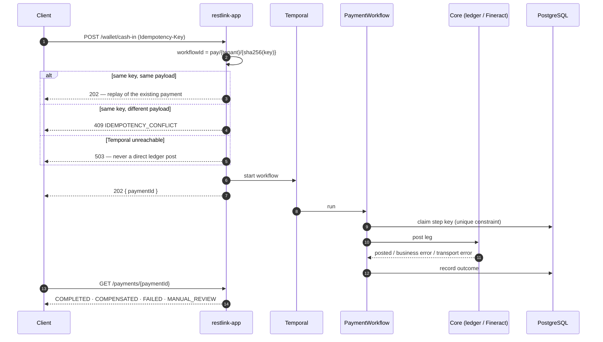

<div align="center">

# 🏦 Restlink Banking Core

**One banking API in front of any core-banking engine.**
Wallets, payments and customer lifecycle on top — Apache Fineract, Temenos or a native ledger underneath.


[](LICENSE)

[Why](#why-restlink) · [Architecture](#architecture) · [Quick start](#quick-start) · [API](#http-api) · [Status](#project-status) · [Contributing](#contributing)

</div>

---

## Why Restlink

A digital bank is rarely one system. Mobile apps, partner APIs and payment rails sit on one side; one or
more core-banking engines sit on the other. The layer in between is where the hard problems live:
retries, timeouts, nodes that restart mid-transfer, and engines that each speak a different dialect.

Restlink is that layer, built around one rule: **money moves exactly once, and the system says so only
when it is true.**

| | |
|---|---|
| 🔌 **Any core, per tenant** | One `CoreBankingPort` SPI. Each tenant is bound to a native ledger, **Apache Fineract** or **Temenos T24/Transact** by configuration. An unbound tenant fails closed — there is no silent fallback. |
| 💸 **Exactly-once money** | Cash-in, cash-out and transfer run as a **Temporal saga**. The idempotency key is claimed *before* the core is called, so a retry replays the result instead of posting twice. |
| 🧭 **N-node high availability** | Any node can answer any request. When a node stops mid-transaction, its peers reconcile it against the core, or park it for manual review. |
| 👤 **Built for large customer bases** | Each customer has their own profile and session state. PostgreSQL holds the full set; the JVM keeps only a bounded working set in memory. |
| 🩺 **Honest status** | A core is reported `live` only after a real round-trip to the engine — not because a connector started. |
| 🔐 **Safe defaults** | Default keys are rejected, an unreachable orchestrator returns `503`, and trust-all TLS needs two explicit lab flags. |

---

## Architecture



### Modules

| Module | Role |
|--------|------|
| [`restlink-api`](restlink-api) | The contract: `CoreBankingPort`, sealed commands and events, domain records, payment keys |
| [`restlink-workflow`](restlink-workflow) | Temporal `PaymentWorkflow` — deterministic, no I/O |
| [`ra-fineract`](ra-fineract) | Adapter for Apache Fineract REST (Idempotency-Key, `externalId` correlation, savings lifecycle) |
| [`ra-temenos`](ra-temenos) | Adapter for Temenos T24/Transact behind the same API (see [Project status](#project-status)) |
| [`restlink-app`](restlink-app) | Bootstrap, customer profiles, wallet, KYC gate, persistence, Temporal workers, HTMX admin |

### How a payment flows (cash-in)



Temporal activities are at-least-once by nature. The unique step key in PostgreSQL turns a second
attempt into a no-op, so a retried activity cannot charge twice. A failed step is compensated; a step
whose outcome cannot be proven goes to `MANUAL_REVIEW` rather than being guessed.

More detail: [`docs/design/04-temporal-payment-saga.md`](docs/design/04-temporal-payment-saga.md).

---

## Quick start

**You need:** [mise](https://mise.jdx.dev) (installs Zulu JDK 25 and Maven 3.9.9), Docker and PostgreSQL 16.

> Restlink runs on **micro-jainslee** (`com.microjainslee:*:1.2.2-SNAPSHOT`), which is not on Maven Central
> yet. Build and install it once from [nhanth87/jain-slee](https://github.com/nhanth87/jain-slee)
> (`mvn -DskipTests install`).

```bash
# 1. Toolchain
mise install

# 2. Temporal dev stack (bound to 127.0.0.1)
docker compose -f deploy/temporal/docker-compose.yml up -d

# 3. Database (Flyway migrates on start)
createdb restlink

# 4. Configuration — API and admin keys are required
cp .env.example .env
#    set RESTLINK_ADMIN_KEY (12+ chars), RESTLINK_API_KEY and RESTLINK_DB_PASS
set -a; . ./.env; set +a

# 5. Build and run
./tools/package-dist.sh && dist/restlink-app/run.sh
```

The app listens on **`:8090`**. Onboard a first customer:

```bash
curl -sS -X POST http://127.0.0.1:8090/customers \
  -H "X-Restlink-Api-Key: $RESTLINK_API_KEY" -H 'Content-Type: application/json' \
  -d '{"tenantId":"et","customerId":"cust-001","firstName":"Ada","lastName":"Lovelace","currency":"ETB"}'
```

When you are done: `docker compose -f deploy/temporal/docker-compose.yml down`.

---

## HTTP API

| Surface | Endpoints |
|---------|-----------|
| **Customers** | `POST /customers` · `GET /customers/{tenant}/{id}` |
| **Wallet** | `POST /wallet/open` · `/cash-in` · `/cash-out` · `/transfer` · `GET …/balance` · `…/history` · freeze / limits (admin) |
| **Payments** | `GET /payments/{paymentId}` · operator retry-reconcile / retry-compensation |
| **Admin** | `GET /admin` (HTMX dashboard) · `GET /admin/status` |

The full contract, status codes and a step-by-step curl walkthrough are in **[`docs/api.md`](docs/api.md)**.

---

## Project status

Restlink is young and honest about it. Everything below is covered by unit tests (89, JDK 25); it has
not yet run in production.

| Area | Status |
|------|--------|
| Native wallet ledger — cash-in, cash-out, transfer | ✅ Implemented |
| Temporal payment saga with compensation and manual review | ✅ Implemented |
| Apache Fineract — live probe, deposit and withdrawal | ✅ Implemented |
| Apache Fineract — native transfer | ⏳ Planned; fails closed until then |
| Temenos T24/Transact | 🔌 Exposed through the same `CoreBankingPort` API. The full OFS/IRIS integration will be built against a licensed Temenos environment; until then, money calls to Temenos fail closed. |
| API keys, KYC gate, API audit, HTMX admin | ✅ Implemented |
| N-node HA (`DIST_SYNC`) | ✅ Implemented |

### Roadmap

- Temenos money operations, once a licensed environment is available
- Cross-provider transfers (Fineract `capture()`)
- Apache Camel integration hub — ISO 8583, ISO 20022, mobile money, FX
- OAuth2 open-banking gateway

Progress log: [`docs/M1-M10-status.md`](docs/M1-M10-status.md).

---

## Security model

- **API keys.** `/customers` and `/wallet` require `X-Restlink-Api-Key`; operator routes require
  `X-Restlink-Admin-Key`. Keys are compared in constant time; unset or default keys are rejected.
- **Money fails closed.** Orchestrator down ⇒ `503`; unbound provider ⇒ error, never a fallback ledger.
- **KYC gate.** New customers start as `PENDING`: cash-in is allowed, cash-out and transfer return `403`
  until an operator approves them.
- **Audit.** Every mutating call is recorded in `api_audit` (time, tenant, actor fingerprint, method, path,
  IP, status). Request bodies and raw keys are never stored; card numbers are redacted.
- **TLS.** Trust-all TLS to Fineract needs *both* `insecure-tls` and `allow-insecure-tls-lab`.
- **Secrets** come from the environment only.

---

## High availability

- Use `RESTLINK_CLUSTER_MODE=DIST_SYNC` for two or more nodes (`LOCAL` is for a single-node lab).
- `requestId` (transport correlation) and `idempotencyKey` (money dedupe) are kept separate and both replicated.
- Requests left by a departed node are adopted by a peer; money is re-driven only by Temporal workers.

Design: [`docs/design/02-nn-ha.md`](docs/design/02-nn-ha.md).

---

## Build, test, package

```bash
mvn test                       # unit tests (JDK 25)
./tools/package-dist.sh        # → dist/restlink-app/ (run.sh + lib/ + app/html/ + configs/)
```

A deployment ships `dist/restlink-app/` only. The packaging script never overwrites an existing
`configs/application.properties`; it writes a `.new` file for review instead. Logging goes through Log4j2.

---

## Contributing

Questions, bug reports and pull requests are all welcome — especially from people who run Fineract or
Temenos in production and can say where the model does not match reality.

- **Discuss first** for larger changes: open an issue describing the problem and the approach.
- **Code style:** Java 25, immutable records where practical, Log4j2 for logging, transport code only
  inside the `ra-*` adapters.
- **Tests:** add or update unit tests with every change; `mvn test` must stay green.
- **Money paths:** any change to payments must keep the exactly-once guarantee — explain in the PR how a
  retry or a node failure behaves.

**Security issues:** please report them privately through
[GitHub Security Advisories](https://github.com/nhanth87/restlink-banking-core-oss/security/advisories/new),
not in a public issue.

---

## Documentation

| Doc | |
|-----|---|
| [`docs/api.md`](docs/api.md) | HTTP contract |
| [`docs/design/00-architecture-overview.md`](docs/design/00-architecture-overview.md) | Architecture overview |
| [`docs/design/02-nn-ha.md`](docs/design/02-nn-ha.md) | N-node request/response HA |
| [`docs/design/03-fineract-best-practices.md`](docs/design/03-fineract-best-practices.md) | Fineract integration practices |
| [`docs/design/04-temporal-payment-saga.md`](docs/design/04-temporal-payment-saga.md) | Payment saga |

---

## Acknowledgements

Restlink stands on the work of the [Apache Fineract](https://fineract.apache.org),
[Temporal](https://temporal.io), [Quarkus](https://quarkus.io) and [PostgreSQL](https://www.postgresql.org)
communities. Temenos and T24 are trademarks of Temenos AG; this project is independent and not affiliated
with or endorsed by Temenos.

## License

Restlink Banking Core is licensed under the **GNU Affero General Public License v3.0** — see [`LICENSE`](LICENSE).
If you run a modified version as a network service, you must offer its source to the users of that service.
