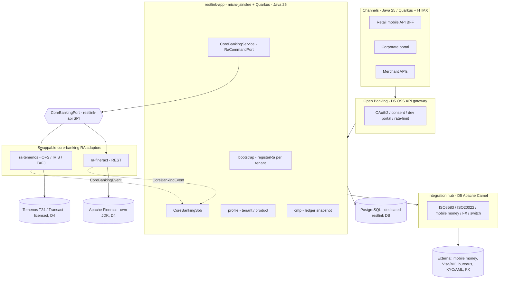

# Restlink Banking Core — Architecture Overview (design)

**Date:** 2026-08-11 · **Target:** multi-country financial institutions
**Status:** design (implementation status: see [`../M1-M10-status.md`](../M1-M10-status.md)).

---

## 0. Locked decisions applied

| # | Decision |
|---|----------|
| D1 | micro-jainslee structure (adaptor/RA, profile, CMP, SBB, bootstrap). Restlink Banking Core is **banking**. |
| D3 | **Core-banking-agnostic** via `CoreBankingPort`. Two swappable RA adaptors: **`ra-fineract`** (Apache Fineract) **and** `ra-temenos` (Temenos T24/Transact). |
| D4 | Fineract/Temenos run on their **own JDK/runtime (escape hatch)**; all `restlink-*` code stays **Java 25**. |
| D5 | **OSS only** for integration → **Apache Camel** (integration/ISO8583/20022) + **OSS API gateway**. |

> **Refinement 2026-08-11:** micro-jainslee (`adaptor`/RA 3-port, `profile`, `cmp`, `sbbs`,
> `bootstrap`) is the reusable asset. Banking adaptors for **both** Fineract and Temenos sit behind
> one `CoreBankingPort`, chosen per tenant.

---

## 1. House-style conventions

Packaging and runtime conventions:

- **Runtime:** Java 25 (mise `zulu-25`) + **Quarkus fast-jar** + **PostgreSQL** (dedicated DB per app).
- **Packaging:** `./build/package-dist.sh` → ship **`dist/` only** (`run.sh` + `lib/` + `app/html/` + `configs/`).
  Never a WAR. **Never overwrite** `dist/configs/application.properties` — write `application.properties.new`
  via `install-config.sh` and diff before adopting. `db-kind` is **build-time**.
- **Deploy:** rsync **jars / lib / quarkus / app/html only** — never `configs/`. Then restart + verify.
- **Prove-the-artifact:** package → ship distro → restart → verify `jar tf` symbol + live surface before "done".
- **Admin:** disk HTML + **HTMX** partials with `{{TOKEN}}`; auth via `X-RESTLINK-Admin-Key` header or `?key=`.
  **Tenant vs admin scoping** (admin key = global; tenant key = tenant-scoped principal). Never render full
  API keys into copy fields. `allow-default-lab-key` toggle for lab.
- **Logging:** **Log4j2** → `dist/logs/`.
- **Status truth:** health/link status must reflect **peer/component truth**, never LISTEN-as-UP
  (here: Fineract reachable, PG up, Camel routes started, gateway healthy — each proven, not assumed).
- **Integration transport lives in adapters** (Camel routes / RA-style Wrapper+Delegate), never ad-hoc in
  business services.

---

## 2. System architecture

### Module map

| Module | Owns |
|--------|------|
| **restlink-api** | `CoreBankingPort`, sealed `CoreBankingCommand` / `CoreBankingEvent`, domain records (`Money`, `CustomerRef`, `AccountRef`) |
| **ra-fineract** | 3-port RA to Apache Fineract REST; maps commands→REST, fires events |
| **ra-temenos** | 3-port RA to Temenos OFS/IRIS/TAFJ (licensed); same command/event contract |
| **restlink-app** | `bootstrap`, `sbbs` (CoreBankingSbb), per-customer `profile` + `cmp`, `persist`, `admin` (HTMX), Camel hub, channels BFF |

### Why this shape
- **Swap by config, not by rewrite.** A tenant picks `FINERACT` or `TEMENOS`; the SBB code is identical.
- **Temenos is licensed/proprietary** — `ra-temenos` is an *integration* adaptor (OFS/IRIS/TAFJ/DFE),
  never a bundled component. Fineract is OSS but still runs as an external component (D4 escape hatch).
- **The RA is the only place transport lives** (house rule) — no HTTP/OFS calls leak into SBBs.

---

## 3. Domain (locked)

Restlink is a **double-entry ledger + ISO switching + wallets** platform. The transferable asset
from other house trees is *discipline* (§1), not classes.

---

## 4. Tenancy & multi-country

- Fineract **multi-tenant**: one tenant per country/entity.
- `restlink-*` services carry `tenantId` on every request; admin/tenant key scoping per house rule.
- Country localization (tax, reporting, accounting standards) via config + per-tenant Camel routes.
- Dedicated PostgreSQL: `restlink` DB for our services + Fineract tenant DBs (isolated).

---

## 5. Security

- OAuth2 at the gateway; mTLS to external switches; consent management for open banking.
- Admin plane fail-closed in prod (no default lab key when `allow-default-lab-key=false`).
- Secrets via env (`RESTLINK_*`), never committed; PCI-adjacent data (PAN) never logged.
- AML/KYC via Camel connectors; audit trail on every ledger-affecting op (Fineract GL + restlink audit).

---

## 6. Delivery phases

| Phase | Deliverable | Prove (artifact + live) |
|-------|-------------|-------------------------|
| **0** | Scaffold (`docs/`, dedicated PG, `dist/` skeleton, `run.sh`, CI) | tree builds; `run.sh` boots; `/admin` HTMX up with key |
| **1** | Fineract adopt (own JDK) + ACL + CIF/KYC + multi-tenant | journal entries balance; tenant onboard; ACL idempotent |
| **2** | Wallet on accounts + merchant wallets + multi-currency | wallet debit/credit reconciles Fineract GL |
| **3** | Camel hub: ISO8583/20022, mobile money, QR, settlement, reconciliation | end-to-end payment proven on wire |
| **4** | OSS API gateway: OAuth2, consent, dev portal | 3rd-party consent + API call proven |
| **5** | Channels: retail mobile MVP + corporate portal | UAT flows green |
| **6** | SIT/UAT, pen-test, go-live, hypercare | prove-the-artifact on host |

Phases 0–2 come first.

---

## 6a. Profile / CMP residency

Postgres holds the full customer set (`customer_profile` + `customer_cmp`). The JVM holds only a
bounded LRU (`restlink.profile.cache-max`, default 10 000) of the active working set. Boot does
**not** rehydrate-all — at 1M customers that would not fit on the heap. Lookups are on-demand
`loadFields` / `COUNT(*)`.

## 6b. N–N request/response HA

Banking correctness across N nodes (exactly-once money, cross-node request↔response correlation,
mid-transaction failover) is specified in [`02-nn-ha.md`](02-nn-ha.md) and implemented in
`restlink-app` (`cluster/` + `core/`).

## 7. Open items (not blocking design)

- **Which OSS API gateway** (D5b): e.g. Apache APISIX vs Gloo/Kong-OSS vs WSO2 — pick in Phase 4.
- **Fineract JDK/version pin** (D4b): confirm supported JDK + Spring line for the external component.
- **AI credit scoring provider** (external): connector spec in Phase 5.
- **Country list** + regulatory scope per country (drives tenancy + localization).
