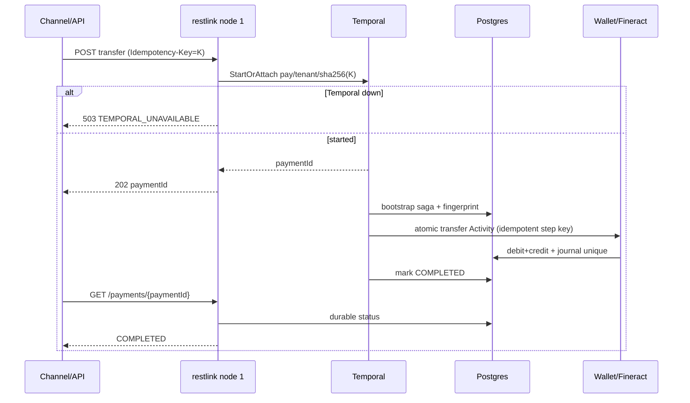

# Restlink Banking Core — N–N request/response HA (banking correctness)

**Date:** 2026-08-11 (updated 2026-08-12 for Temporal money plane).
**Mechanism:** Temporal durable workflows for **all money** + Infinispan DIST_SYNC for non-money correlation + Postgres durable fences.

> **Requirement:** the platform runs **N nodes**. A money request accepted on any node must produce **exactly
> one** correct business effect (no double-debit / no double-credit). Temporal owns money orchestration and
> worker failover; Postgres unique keys fence Activity at-least-once retries. Never LISTEN/started = ready.

---

## 1. Guarantees

| Guarantee | Mechanism |
|-----------|-----------|
| **Exactly-once money effect** | Temporal `PaymentWorkflow` + durable step keys in `txn_journal` / provider idempotency. See [`04-temporal-payment-saga.md`](04-temporal-payment-saga.md). |
| **Request↔response correlation** | Durable `payment_saga` + Temporal workflow id; poll `GET /payments/{paymentId}`. Non-money still uses `PendingRequestStore`. |
| **Mid-transaction node death (money)** | Temporal worker on a peer continues the workflow — **no** hand-rolled money adopt. |
| **Mid-transaction node death (non-money)** | `RestlinkClusterViewBridge` adopts orphaned OpenAccount/CreateCustomer only → `NEEDS_REVIEW`. |
| **Temporal unreachable** | Money APIs return **503**; never direct ledger post. |
| **Core liveness truth** | `coreLive` only after a real engine probe; `temporal.moneyReady` = frontend reachable **and** workers polling. |

---

## 2. Flow (money happy path)

---

## 3. Invariants (do / never)

- **Money only via Temporal.** `CoreBankingService` refuses direct `PostTransaction` / `TransferFunds` / `ReverseTransaction`.
- **Claim durable step keys BEFORE trusting a retry.** Unique index is the anti-double-charge fence.
- **`requestId` ≠ `idempotencyKey`.** Workflow id hashes the client key; never store raw key in Temporal history.
- **Compensate, don't guess.** Ambiguous provider outcome → reconcile by step key; unknown → `MANUAL_REVIEW`.
- **DIST_SYNC for multi-node non-money caches; `LOCAL` only for single-node lab.**
- **Never** re-drive money from `RestlinkClusterViewBridge`.

---

## 4. Components

| Class | Role |
|-------|------|
| `payment/PaymentService` | Start/attach Temporal workflows; fail-closed when Temporal down |
| `temporal/TemporalRuntime` | Client + workers; `moneyReady` peer truth |
| `temporal/PaymentActivitiesImpl` | Idempotent money Activities → wallet / ports |
| `workflow/payment/PaymentWorkflowImpl` | Deterministic Saga (compensation pre-registered) |
| `cluster/RestlinkClusterViewBridge` | Non-money orphan adopt only |
| `core/PendingRequestStore` | Non-money correlation (DIST_SYNC) |

Admin `/admin/status`: `temporal.moneyReady`, saga counts, inbox pending — peer truth.

Detail: [`04-temporal-payment-saga.md`](04-temporal-payment-saga.md).
